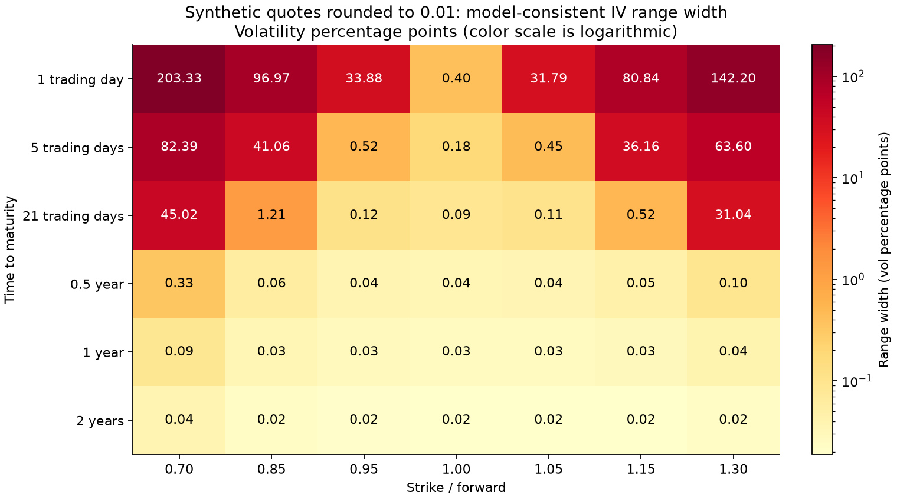
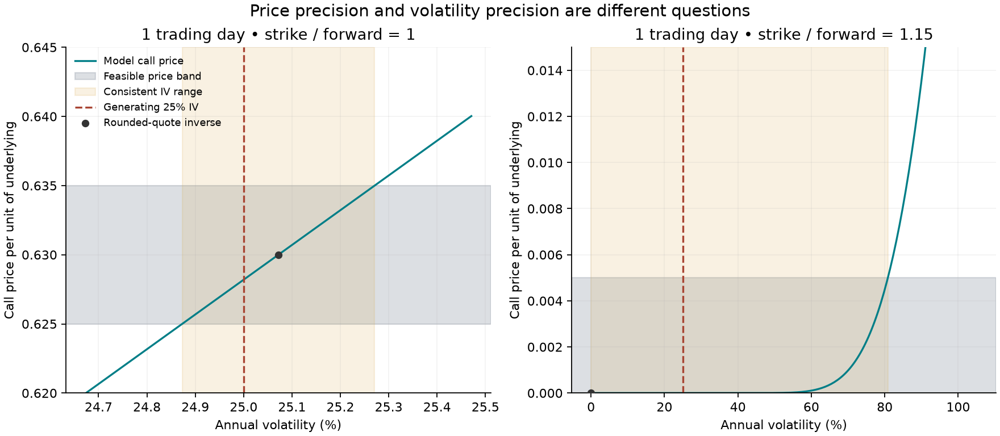

# Implied Volatility Conditioning Lab

A small quantitative-research project about **inverse-problem conditioning**:
an excellent option-price fit can coexist with an unreliable volatility estimate.
The original implementation combines forward-Black pricing, bracketed inversion,
explicit boundary states, and propagation of quote-resolution intervals.

The experiment uses **deterministic synthetic European call quotes**, not market
data. All generating volatilities equal 25%; no volatility surface is learned.
This is educational research software, **not investment advice**, a trading
strategy, a production pricer, or evidence of financial returns.

## Reproduce

Python 3.11 or newer:

```bash
python3 -m venv .venv
source .venv/bin/activate
python -m pip install '.[test]'
python -m pytest -W error
iv-audit --output artifacts
```

The CLI writes `summary.json` and two PNG figures. No network, external data,
credentials, or optional market-data service is required. `--tick 0.001` explores
a finer quote resolution. The default is 0.01 price units per unit of underlying,
not an assertion about any exchange's actual tick rules.

The fixed-grid CLI deliberately supports tick sizes from 1e-6 to 1. The separate
interval-inversion API also handles intervals with infinite upper IV. For the
committed Python 3.13 versions, install with
`python -m pip install -c constraints-py313.txt '.[test]'` instead. Same-environment
reruns produce identical JSON; cross-platform numerical variation is possible.

## Results from the committed run

All 42 quote-consistent ranges contained the known generating **25%** volatility.
After rounding, 34 point quotes had interior solutions, six were at the lower
boundary, and two violated individual price bounds. Those two point quotes were
rejected while their resolution bands still had feasible intersections.

Examples with **one trading day to expiry**, all generated at 25% volatility:

| Strike / forward | Rounded call quote | Point-quote IV | Quote-consistent IV range |
| --- | ---: | ---: | ---: |
| 0.70 | 30.00 | 187.75% | 0%–203.33% |
| 1.00 | 0.63 | 25.07% | 24.87%–25.27% |
| 1.15 | 0.00 | 0% (lower-bound limit) | 0%–80.84% |

The 187.75% estimate repriced its rounded input with **zero float64 residual**,
yet differed from the generating volatility by **162.75 percentage points**.
This is not a failure to solve the supplied inverse problem: the rounded input
is different from the generating price, and low Vega amplifies that difference.
Across all 34 interior rounded quotes the maximum repricing error was **8.32e-13**
price units (rounded up). Local `tick/vega` is not a reliable global bound in
these flat-tail cases; the report retains both it and the nonlinear range.





Before quote quantization, 39 float64 call prices remained interior and recovered
volatility to within **2.50e-11** absolute decimal-volatility error (rounded up).
Three ITM prices had already lost their time value when it was added to intrinsic
value; they correctly returned a boundary label instead of a claimed 25% recovery.
Full-precision records are in [summary.json](artifacts/summary.json).

The **59-test** suite covers an independent 100-digit `mpmath` pricing reference,
tiny positive OTM prices, analytic Vega versus finite differences, reciprocal-Vega
inverse sensitivity, currency rescaling, price boundaries, lost ITM time value,
quote-range endpoints, unbounded ranges, explicit iteration/bracket failures,
deterministic replication, and the complete CLI. GitHub Actions runs tests and
the default experiment on Python 3.11 and 3.13.

## Model and numerical design

Let F be the forward, K the strike, T time in years, D a positive discount
factor, and sigma annual volatility in decimal units (0.25 means 25%).

```text
s = sigma sqrt(T)
d1 = log(F/K)/s + s/2; d2 = d1 - s
C = D [F Phi(d1) - K Phi(d2)]
vega = dC/dsigma = D F phi(d1) sqrt(T)
individual call bounds: D max(F-K,0) <= C <= D F
```

Pricing uses the out-of-the-money (OTM) leg: an OTM call when F<=K, or an OTM put
plus discounted intrinsic value when F>K. The OTM subtraction is evaluated using
`log_ndtr` and `expm1`. Inversion subtracts discounted intrinsic from the supplied
call price, and solves for **total standard deviation** s, not annual volatility.
The scalar residual is

```text
tanh(0.5 [log(model OTM value) - log(target OTM value)])
  = (model OTM value - target OTM value) / (model OTM value + target OTM value).
```

This bounded, relative residual avoids a fixed absolute price stopping rule that
could accept a poor inverse for a tiny OTM quote. SciPy's Brent method is used
after expanding a sign-changing bracket. Total-std absolute/relative tolerances
are 1e-13; a separate repricing check requires absolute error <=1e-10 times
max(1, D F). A small price residual is a numerical check, **not** a volatility
accuracy guarantee. Default maximum total std is 64 and iteration budget is 300;
exhaustion raises an explicit error.

Boundary handling is deliberate:

| Input price | Result |
| --- | --- |
| Strictly inside the bounds | Finite interior implied-volatility estimate |
| Exactly at discounted intrinsic | `lower_boundary`, zero-volatility limit |
| Exactly at D F | `upper_boundary`, infinite-volatility limit; JSON volatility is null |
| Outside the bounds | Rejected, not silently clipped or assigned a fallback volatility |

At expiry the payoff can be priced, but inversion requires T>0. For positive T,
boundary labels describe mathematical limits, not finite positive-volatility
solutions. In particular, a float64 ITM call can lose its tiny time value when
it is added to intrinsic value. If that happens, no solver can recover the missing
information from the rounded total price. The full-precision-input audit also
records this effect; "unrounded" means before quote quantization, not arbitrary
precision arithmetic.

## Quote-consistent ranges

A nearest-tick rounded quote q with tick size delta represents the closed price
band `[q-delta/2, q+delta/2]`. The code explicitly intersects it with the individual
call bounds, records the original and feasible endpoints, then inverts each
endpoint. Closed endpoints conservatively include rounding ties. `numpy.rint`
uses ties-to-even; binary arithmetic can perturb exact ties.

This yields a **model-consistent range**, not a confidence or credible interval.
Its uncertainty source is the stated quote precision, not a sampling model. A
band reaching D F has an unbounded upper volatility; a band with no finite-volatility
price is rejected. A rounded point quote can violate an individual bound even
though its full resolution band overlaps feasible prices.

Locally, `d sigma / d C = 1 / vega`, so a price-band width delta suggests an
IV width of roughly `delta/vega`. The JSON reports that linear approximation
separately from the inverted range. In flat tails it can be wildly inaccurate:
the finite range is obtained by nonlinear inversion, not by treating the local
approximation as a global error bound.

## Experiment

42 contracts: F=100, sigma=0.25, D=exp(-0.03 T); T is 1/252, 5/252, 21/252,
0.5, 1, or 2 years; K/F is 0.7, 0.85, 0.95, 1, 1.05, 1.15, or 1.3.
For every contract the audit stores the synthetic price, rounded quote, Vega,
full-precision-input inverse, rounded-point inverse status, nonlinear quote range,
and local linear sensitivity. It checks that all default quote ranges contain
the known generating volatility. This is a deterministic numerical experiment,
not a Monte Carlo study or statistical coverage claim.

## Scope and limitations

- European calls with known positive forwards/strikes/discount factors and
  constant lognormal volatility; no American exercise, stochastic volatility,
  bid/ask microstructure, forward uncertainty, or model-risk adjustment.
- Individual price bounds do **not** establish joint calendar, butterfly, or
  cross-strike arbitrage consistency. Independently rounded synthetic quotes
  need not form an arbitrage-free surface.
- Float64 arithmetic has underflow, cancellation, and representability limits.
  The log formula and tests improve reliability in this experiment's range;
  this is not a full-domain, maximum-precision solver or an implementation of
  Jäckel's specialized algorithm. Extreme scales require further safeguards.
- A more precise numerical root cannot restore information lost to quote rounding
  or an ITM price's floating-point representation. High implied volatility from
  an uncertain price does not by itself imply a market opportunity.
- No market calibration or timing benchmark, trading performance, or new option
  pricing theorem is claimed.

## References

- [Scholes, Nobel lecture (1997)](https://www.nobelprize.org/uploads/2018/06/scholes-lecture.pdf):
  background on the Black–Scholes option-pricing framework.
- [Jäckel (2015), Let's Be Rational](https://doi.org/10.1002/wilm.10395):
  a specialized high-accuracy implied-volatility method; cited as context, not
  copied or implemented here.
- SciPy's [Brent solver](https://docs.scipy.org/doc/scipy/reference/generated/scipy.optimize.brentq.html)
  and [log normal CDF](https://docs.scipy.org/doc/scipy/reference/generated/scipy.special.log_ndtr.html).

Original code and experiment design using established mathematics. MIT licensed.
